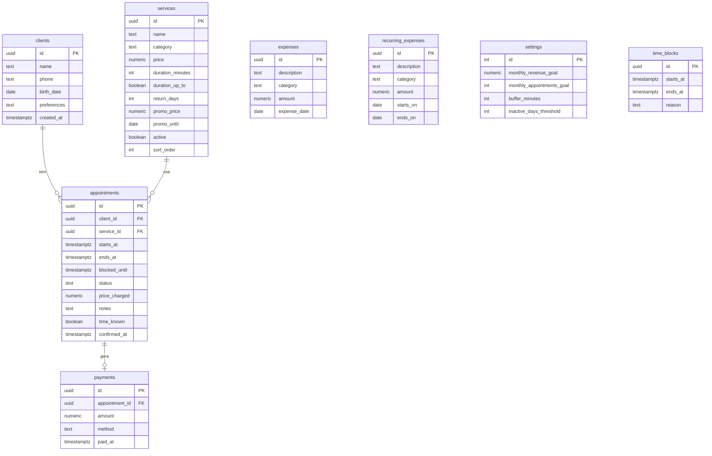

# Modelo de Dados (Supabase / PostgreSQL)

As tabelas da Fase 2 (`settings`, `services`, `clients`, `appointments`) estão em [`supabase/migrations/`](../supabase/migrations/). As de pagamentos e despesas entram na Fase 3. **O banco só muda por migração**, nunca por cliques no painel do Supabase.

## Diagrama

## Tabelas

- **clients:** nome, telefone (guardado só com dígitos, com DDI), data de nascimento (opcional, para aniversários e campanhas futuras) e preferências. Sem e-mail nem senha. Gasto total, serviço e horário favoritos **não são colunas**: são calculados dos atendimentos (`lib/client-stats.ts`).
- **services:** os 7 serviços atuais. `category` é o grupo da landing page ("Fibra e gel", "Tradicional"). `duration_up_to` indica duração máxima ("até 2 h"). `return_days` é o prazo de retorno sugerido depois de concluir (30 por padrão; vazio = serviço avulso, sem sugestão). Serviço usado em atendimentos antigos é **desativado**, nunca apagado, para preservar o histórico.
- **appointments:** `status` em `scheduled | completed | cancelled | no_show`. `price_charged` guarda o valor cobrado na hora, de modo que mudar o preço do serviço não altera o passado. Um gatilho (`appointments_fill`) preenche sozinho:
  - `ends_at` = `starts_at` + duração do serviço, se não for informado. Ao remarcar, mantém a duração; ao trocar o serviço, recalcula.
  - `blocked_until` = `ends_at` + intervalo das configurações.
  - `price_charged` = preço atual do serviço, se não for informado.
  - Sem serviço, a duração padrão é de 1 hora.
- **Lançamento de atendimento antigo** (desde 2026-10-24): `client_id` e `service_id` podem ser nulos, e `time_known = false` marca o atendimento em que ela não lembra o horário (fica ao meio-dia do dia e **não ocupa a agenda**). A função `record_past_appointment` grava o atendimento já concluído e o pagamento numa transação só e recusa datas futuras. O agendamento normal continua exigindo cliente e serviço (validação na tela).
- **Confirmação da véspera** (desde 2026-10-26): `confirmed_at` guarda quando a cliente confirmou o lembrete; vazio = ainda não confirmou. Remarcar limpa a confirmação.
- **payments:** um pagamento por atendimento concluído. `method` em `pix | cash | debit | credit | unknown` (`unknown` = "Não informado", só nos lançamentos antigos). `paid_at` é a data do atendimento, para o faturamento contar no dia do serviço. Gravado pela função `complete_appointment`, que conclui e registra o pagamento numa transação só; `reopen_appointment` desfaz.
- **expenses:** despesas **do dia a dia** (na tela; "avulsas" no código), com data. `category` em `rent | bills | mei | materials | equipment | courses | transport | food | marketing | other`, com os nomes em `lib/expenses.ts`.
- **recurring_expenses:** despesas **fixas** (aluguel, MEI), que entram em todo mês entre `starts_on` e `ends_on` (meses guardados como o dia 1). Mudar o valor encerra a versão antiga no mês anterior e cria uma nova a partir do mês atual: os meses passados não mudam.
- **settings:** linha única com metas (R$ 3.600 e 30 atendimentos), intervalo entre atendimentos e dias para considerar uma cliente "sumida".

## Regras de integridade

- **Conflito de horário barrado no banco:** dois atendimentos `scheduled` ou `completed` não podem ocupar o mesmo período de `starts_at` a `ends_at` (restrição de exclusão `appointments_no_overlap`, erro `23P01`). Desde 2026-10-27 o intervalo (`blocked_until`) **não trava**: a tela só avisa quando o horário fica colado em outro. Cancelados, faltas e lançamentos sem horário (`time_known = false`) liberam o horário. A tela traduz o erro para uma mensagem amigável.
- **Vários serviços num atendimento** (desde 2026-10-27): `appointment_services` guarda cada serviço (com o preço e a duração do dia); `appointments.service_id` continua sendo o primeiro, e `appointments.services_label` guarda o nome pronto ("Manicure + Pedicure"). A função `create_appointment` grava tudo numa transação, com a duração somada.
- **Promoção:** `services.promo_price` vale até `promo_until` (inclusive). Os dois andam juntos. O preço fica gravado no item do atendimento no dia em que ela agenda: **atendimento marcado com promoção mantém a promoção**, qualquer que seja a data dele (decisão do Hygor, 2026-10-28).
- **Editar atendimento** (desde 2026-10-28): `update_appointment` troca cliente, serviços, valor, observações, dia e horário numa transação; no concluído, também o pagamento (valor, forma e dia). Serviço que já estava mantém o preço e a duração de quando foi marcado. Desde a mesma migração, todo atendimento com serviço tem a linha em `appointment_services` (os antigos ganharam a sua), e os agendamentos futuros de antes da tabela nova passaram para as durações e preços novos.
- **Despesa fixa revisada** numa transação só (`revise_recurring_expense`).
- **Bloqueios de horário** (desde 2026-10-27): `time_blocks` guarda folgas e compromissos (`reason` opcional; dia inteiro = da meia-noite à meia-noite seguinte). Tabela separada para não entrar em nenhuma conta de atendimentos. Dois gatilhos mantêm a regra nos dois sentidos, com o mesmo erro `23P01`: `appointments_not_blocked` recusa atendimento ativo (com o intervalo) que cai num bloqueio, e `time_blocks_free` recusa bloquear em cima de atendimento ativo.
- Clientes e serviços com atendimentos não podem ser apagados (`on delete restrict`).
- Telefone guardado só com dígitos e DDI (12 ou 13 dígitos).
- Valores monetários em `numeric(10,2)`.
- Horários em `timestamptz`, exibidos em America/Sao_Paulo.

## Segurança (RLS)

- RLS habilitado em **todas** as tabelas.
- Política: qualquer usuário autenticado lê e escreve. Isso só é seguro porque **o cadastro público está desligado** no Supabase, e a única conta é a da Gabriela.
- A landing page (papel `anon`) lê apenas os serviços ativos. A tabela de serviços não tem dados sensíveis, então não precisa de view.
- Segunda camada: as permissões que o Supabase dá ao `anon` por padrão são retiradas (`revoke`). Mesmo com o RLS desligado por engano, clientes e agenda continuam fechados.

## Decisões

- **Intervalo entre atendimentos:** valor único em `settings`, 15 minutos, confirmado (2026-10-09).
- **"Hora de voltar"** (desde 2026-10-27): a cliente entra na lista quando o retorno do serviço da última visita (`services.return_days`) chega em até 3 dias ou já passou, e ela não tem nada marcado. Serviço avulso (sem prazo) não entra; sem serviço registrado, vale 30 dias.
- **Cliente "sumida":** dentro da "Hora de voltar", a que passou de 45 dias sem atendimento (ajustável em `settings`). Recebe um convite de tom diferente.

## Pendências

- Confirmar com a Gabriela os 45 dias para cliente "sumida".
